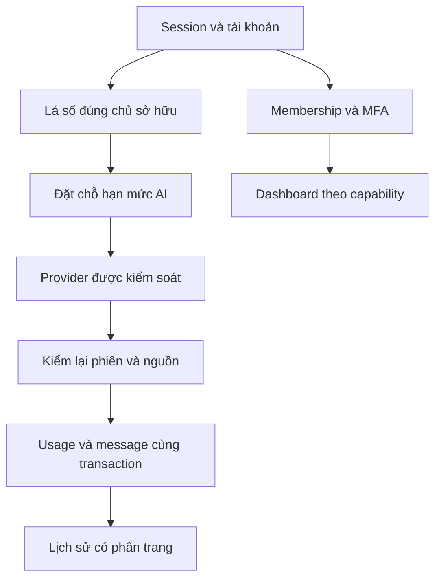

# THIÊN ĐỒ — kiểm toán chuyên sâu A83, vòng 2

Ngày 23/10/2026. Giữ **V11.164.103 / A83 — NO_GO**. Vòng này tiếp tục checkpoint `17577a5`, tập trung tài khoản, phiên đăng nhập, AI người dùng, lịch sử, quyền quản trị và kiểm chứng SQL/HTTP/browser. Một AI thực hiện các góc nhìn chuyên môn, không có xác nhận độc lập của nhiều người.

## Thay đổi có nguyên nhân và bằng chứng

| ID | Vị trí | Lỗi / nguyên nhân | Mức | Sửa chữa / kiểm chứng |
|---|---|---|---|---|
| AI-SESSION | apps/api/src/modules/auth/auth.service.ts; huyen-giai/huyen-giai.service.ts | Chỉ kiểm tra phiên lúc bắt đầu. Trong lúc chờ Gemini, logout/hết hạn/khóa tài khoản vẫn có thể hoàn tất và trả kết quả riêng | P1 | Kiểm tra phiên đúng chủ sở hữu trong transaction trước đặt chỗ ngân sách và trước lưu kết quả; giữ khóa đọc session/user trong ranh giới commit. Test SQL mới ban đầu FAIL 5/8, sau sửa PASS; có HTTP và browser kiểm tra logout khi provider đang chờ |
| AI-CONTEXT | huyen-giai/huyen-giai.service.ts | Lá số bị xóa làm conversation.chart_id=NULL; callback Gemini vẫn lưu câu trả lời tách khỏi ngữ cảnh nguồn | P1/P2 | Kiểm tra lại lá số/cuộc hội thoại thuộc đúng tài khoản, khóa nguồn trong transaction; trả 404 thay vì báo lỗi provider 503. Không lưu message, đóng reservation theo chi phí dự phòng |
| AUTH-DISPLAY | apps/web/src/lib/api.ts; components/auth-provider.tsx | API riêng trả 401 nhưng màn hình còn giữ danh tính/dữ liệu đến lần kiểm tra phiên sau | P1 | Phát tín hiệu khi đã nhận status 401, gỡ cây UI riêng, hủy thế hệ request cũ và trở về trang đầu; đồng bộ logout tab. Loại trừ lỗi mật khẩu/OTP và 403. Test actual React/AuthProvider/API transport, late /me và browser logout giữa yêu cầu |
| AI-HISTORY | backend huyen-giai service/controller; frontend use-huyen-giai/types/response-contract/page | ORDER BY tăng dần LIMIT 80 chỉ trả 80 lượt đầu; câu trả lời mới bị che trong hội thoại dài | P2 | Trả 80 lượt gần nhất, thêm cursor trước đó gắn đúng user/conversation; giữ độ chính xác microsecond trong SQL và UUID tie-breaker. Thêm nút Xem các lượt trước, chống nhấn trùng/ghi đè khi đổi cuộc. SQL 165 lượt và browser 167 lượt |
| QA-DOM | tests/tool-login-dom.test.mjs | Harness cũ không tải alias/JSON, không dựng AdminSession/MFA, dùng Event sai realm và fixture API đã cũ | P2 QA | Dùng module cache, resolver thực, provider bảo mật và fixture đúng API hiện hành; giữ kiểm tra quyền, giá và nội dung Pro. Không bỏ các test thất bại |
| QA-BROWSER | tests/helpers-browser-launch.cjs; browser harnesses | Chromium single-process làm fetch giữa browser context dùng cookie của context khác, dù navigation và request API riêng vẫn đúng | P1 QA | Tái hiện ngoài Thiên Đồ bằng HTTP server tối thiểu; dùng renderer tách biệt, giữ web security. Helper từ chối các cờ làm sai nghiệm thu đa tài khoản. Đây là lỗi cấu hình QA, không được ghi thành lỗ hổng đã chứng minh của sản phẩm |

Không thay thuật toán huyền học, công thức cấp bậc, ảnh/font, cơ chế MFA, lockfile hoặc migration. Không tạo tài khoản quản trị dùng chung, không push/deploy và không gọi provider thật.

## Bản đồ dữ liệu và quyền đã đi sâu

SQL test sử dụng 36 migration và service thật trong PGlite memory, từng file tiến trình riêng. HTTP đi qua Next standalone → Nest controller/policy → SQL: 30 request, 16 tổ hợp method/route, 5 kịch bản. Kiểm tra Owner gồm xác minh email bằng mã capture, setup và xác nhận TOTP thực tế; vai trò ban đầu chỉ seed trong database test riêng. Staff overview.read không đọc được members/finance qua console hoặc chat. Tài khoản khác không mở được lá số/lịch sử.

Gemini được thay transport bằng phản hồi có kiểm soát; email được capture, không gửi ra ngoài. Các test mô phỏng provider không chứng minh key/model/quota hay độ sẵn sàng của dịch vụ thật. PGlite không chứng minh PostgreSQL native, process concurrency hoặc backup/restore môi trường đích.

## Giao diện và tính liên tục

Lịch sử dài mở phần mới nhất; tải các lượt trước giữ các câu trả lời đã có. Khi tải lỗi, giữ nguyên message/cursor để thử lại. Chuyển cuộc hoặc reset hủy quyền cập nhật của phản hồi cũ. Status 401 riêng tư không bị hiểu thành lỗi Gemini; lỗi sai mật khẩu/OTP hoặc thiếu capability không tự đăng xuất một phiên hợp lệ.

Đã bổ sung test React DOM và browser thật cho các hành vi trên. Kết quả, số nhóm và giới hạn hiện hành nằm tại TEST_MATRIX.md. Browser dùng Chromium headless Linux và SwiftShader; không suy kết quả sang Safari/iPhone, Edge, Firefox hoặc GPU thiết bị thật.

Kiểm kê tĩnh hiện có 82 route, 231 endpoint, 348 module frontend, 220 module có JSX, 2.006 vị trí JSX tương tác tiềm năng. Đây không phải 2.006 nút đã đạt đủ 20 tiêu chí. FUNCTION_INVENTORY.md/JSON giữ danh mục tĩnh; báo cáo runtime chỉ chấp nhận các kịch bản có bằng chứng.

## Kế thừa vòng 1

Next.js đã vá 16.4.0 → 16.4.2. Manifest RWS được hiệu chỉnh sau khi đối chiếu đủ 78 ảnh gốc khớp checksum cũ và từng cặp ảnh nén; byte ảnh/ID/thumbnail giữ nguyên. Baseline nhận vào 3.156/3.161 Node test; kết thúc vòng 1 đạt 3.161/3.161, full build và 73 route HTTP guest. Toàn bộ bằng chứng cũ giữ ở verification/master-audit; không dùng thay cho lượt kiểm tra mới.

Nguồn ZIP ban đầu không có .git. Repository hiện tại chỉ có checkpoint kiểm toán cục bộ; chưa xác minh remote/HEAD hoặc lịch sử secret upstream. SHA-256 lockfile giữ nguyên so với checkpoint vòng 1. Giữ cả 11 release gates OPEN.

## Việc chưa xong

Chưa kiểm hết từng route/nút/state, chưa đủ đối chứng mọi môn, 11 tên sao và 4 dị danh còn nghiên cứu. Chưa PostgreSQL native/Windows, Safari/iPhone, provider thật, legal approval, staging, backup/restore và hiệu năng thiết bị. Không nâng V12/GO. Tiếp tục theo KNOWN_ISSUES.md và RELEASE_READINESS.md.
